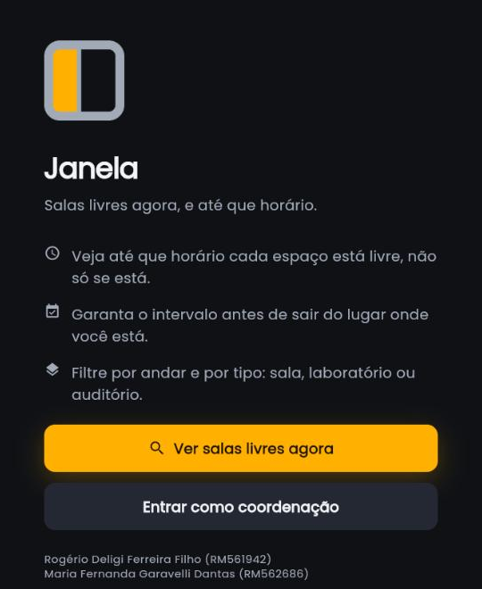

# Janela

**Salas livres agora, e até que horário.**


**A visão do produto**: um app que responde, numa tela, quais salas, laboratórios e auditórios do campus estão livres neste momento e até que horário, deixa o aluno reservar o intervalo pelo celular, e devolve à coordenação um painel de demanda construído sobre os mesmos dados.

**O que este checkpoint entrega**: o alicerce. Marca e identidade visual definidas, a estrutura do projeto criada, o mock de espaços escrito, e a tela de entrada rodando. As telas de lista, filtro, detalhe e reserva chegam no CP5 e no CP6, e a tabela da seção `c)` diz qual funcionalidade entra em qual etapa.

Projeto integrado dos Checkpoints 4, 5 e 6 de Cross-Platform Application Development. Este repositório é a entrega, e ele cresce a cada checkpoint em vez de ser substituído.

| | |
|---|---|
| Disciplina | Cross-Platform Application Development |
| Professor | Hercules Ramos |
| Curso | Ciência da Computação, 2º ano, turma 2CCPW |
| Instituição | FIAP, 2º semestre de 2026 |
| Tecnologia | Flutter 3.47.2 e Dart 3.13.2 |
| Etapa atual | **Checkpoint 4: idealização** |

---

## a) Integrantes e papel de cada um

**Composição do grupo.** O enunciado prevê grupos de 4 a 6 alunos. Este projeto é entregue por uma dupla, e é uma decisão nossa, não um esquecimento: somos a mesma dupla que assinou os dois checkpoints anteriores desta disciplina, e preferimos manter a continuidade do projeto a montar um grupo novo no meio dele. Para cobrir as quatro frentes do checkpoint com duas pessoas, cada um é responsável por duas e revisor das outras duas, em vez de haver um revisor dedicado.

| Nome | RM | Frente principal | Revisa |
|---|---|---|---|
| Rogério Deligi Ferreira Filho | RM561942 | Marca e naming · projeto Flutter e repositório | tudo da Maria Fernanda |
| Maria Fernanda Garavelli Dantas | RM562686 | Identidade visual · documentação e pitch | tudo do Rogério |

**Entregáveis concretos de cada frente neste checkpoint**

| Frente | Responsável | O que saiu |
|---|---|---|
| Marca e naming | Rogério | nome, naming rationale, tom de voz e as microcopy padrão, em [`docs/MARCA.md`](docs/MARCA.md) |
| Identidade visual | Maria Fernanda | paleta com contraste verificado, tipografia, logo e regras de uso, em [`docs/MARCA.md`](docs/MARCA.md); arquivos em `assets/images/` |
| Documentação e pitch | Maria Fernanda | este README e [`docs/PITCH.md`](docs/PITCH.md) |
| Projeto Flutter e repositório | Rogério | árvore `lib/`, tema, tela de entrada, mock de espaços e testes |

Nenhum dos dois aprova o próprio trabalho. A revisão é cruzada em código e em texto: a `app_colors.dart` é escrita por quem programa, mas os valores são da frente de identidade visual, e quem definiu a paleta confere se o hexadecimal chegou certo.

**Divisão já acordada para os próximos checkpoints**, para não renegociar depois. No CP5, Rogério fica com o shell de navegação e com a lista de espaços mais os filtros; Maria Fernanda fica com a Home, o card de espaço, a tela de detalhe e o amadurecimento do mock. No CP6, Rogério fica com o fluxo de reserva e com a geração e o teste do APK; Maria Fernanda fica com a aba de reservas, o cancelamento e o painel da coordenação. A apresentação em aula e a leitura final da documentação são feitas pelos dois.

---

## b) Sobre o projeto

### O problema

Todo campus tem mais espaço vazio do que parece, mas o único registro confiável de uso é a grade horária, e a grade só sabe onde tem aula marcada. O que sobra entre duas aulas, o que vaga quando um professor falta e o que fica livre nos primeiros horários da noite não aparece em lugar nenhum.

Na prática o aluno resolve isso subindo andar por andar e olhando pela janela da porta. Quando finalmente acha uma sala vazia, ainda não sabe se entra turma ali em dez minutos, então o grupo se instala sem garantia e às vezes é expulso no meio do trabalho.

Do outro lado, a coordenação vê a grade e não a ocupação real. Aula cancelada continua ocupando a sala no papel, sala vaga não aparece como capacidade disponível, e ao mesmo tempo chegam reclamações de falta de espaço para trabalho em grupo. A decisão de realocar turma ou de reservar verba para uma sala nova é tomada sem número de uso.

### Público-alvo

**Primário: aluno com trabalho em grupo presencial.** Grupos de 2 a 6 alunos de graduação que precisam de uma sala ou laboratório por 1 a 2 horas, tipicamente no intervalo entre aulas.

A dor é específica: a busca por espaço é feita a pé e no escuro. Sobe o andar, olha pela porta, testa a maçaneta. Achando uma sala vazia, não tem como saber se ela está vazia por vinte minutos ou pelo resto da tarde. A alternativa é disputar mesa em área comum, onde não se consegue falar em voz alta nem usar lousa. O ganho é ver numa lista o que está livre agora, com o horário em que a sala volta a ser usada, e reservar antes de sair do lugar onde está.

**Secundário: aluno do turno noturno e quem vai ao campus fora do próprio horário de aula.** Aqui o deslocamento já foi feito e é irreversível, então o custo do erro é alto: chegar e descobrir que o laboratório está em manutenção ou que o andar inteiro está em aula significa uma viagem perdida. O ganho é consultar pelo celular antes de subir, ou antes de sair de casa, com status de manutenção como informação de primeira classe e não como surpresa na porta.

**Terciário, e é quem pagaria: coordenação de curso ou operação do campus.** O aluno não paga por um app do próprio campus, então este é o lado que assinaria o contrato. O que a coordenação ganha é um painel com a demanda declarada pelos alunos: quais andares e faixas de horário concentram pedido, e quanto do espaço aparece como livre em cada turno.

### Proposta de valor

App que responde em uma tela quais salas, laboratórios e auditórios do campus estão livres agora e até que horário, permite ao aluno reservar o intervalo pelo celular, e devolve à coordenação um painel de demanda construído sobre os mesmos dados.

### Continuidade com o 1º semestre

O domínio é o mesmo de dois projetos que a dupla já entregou em React Native com Expo:

- **CP1**: [`fiap-cpad-cp1-salas-app`](https://github.com/RogerioOxy/fiap-cpad-cp1-salas-app), consulta de disponibilidade com listagem, status visual e filtro por andar.
- **CP2**: [`fiap-cpad-cp2-salas-app`](https://github.com/RogerioOxy/fiap-cpad-cp2-salas-app), evolução direta, com cadastro e login persistidos, reserva por usuário, busca em tempo real e tema claro e escuro.

O que muda no 2º semestre é o stack, que passa a ser Flutter, e o posicionamento. O nome "FIAP Salas" sai porque é apenas descritivo, usa marca de terceiro e amarra o modelo de negócio a um cliente único. O produto passa a ser software para universidades em geral, com a FIAP como cliente piloto. O tema não mudou: mudou de quem é o produto.

---

## c) Funcionalidades do MVP

Toda funcionalidade abaixo é construível com o que as aulas CPAD 13 a 16 e o Guia Prático ensinaram. A única dependência externa que o app usa é `google_fonts`. O `cupertino_icons` que o `flutter create` declara ficou no `pubspec.yaml` e não é importado em nenhum arquivo.

| Funcionalidade | Entra em |
|---|---|
| Tela de entrada com a marca, a proposta de valor e as duas portas de acesso, aluno e coordenação | **CP4** |
| Painel do momento: quantos espaços livres, ocupados e em manutenção, com atalho para a lista | CP5 |
| Lista de espaços com status visual e o horário até quando cada um está livre | CP5 |
| Filtro por andar e por tipo de espaço, em tempo real | CP5 |
| Detalhe do espaço: capacidade, andar, uso atual, próximo uso e horários oferecidos | CP5 |
| Reserva de um horário disponível, com confirmação visível | CP6 |
| Aba de reservas do usuário, com cancelamento | CP6 |
| Painel da coordenação: ocupação por andar e horários mais pedidos | CP6 |

### O que ficou fora do MVP, e por quê

| Fora | Motivo |
|---|---|
| Backend real e integração com a grade horária | O CP5 diz que os dados são mockados e sem backend, e HTTP não foi visto nas aulas 13 a 16 |
| Persistência local | Nenhum pacote de armazenamento foi ensinado, então a reserva desaparece ao fechar o app. O CP2 tinha isso com AsyncStorage, e a perda é consciente |
| Login com senha de verdade | Sem biblioteca de autenticação e sem backend, um login real seria senha em texto puro num arquivo Dart, o que é pior do que não ter login |
| Check-in na sala, por QR code ou crachá | É o item mais importante que fica fora, e a consequência é direta: sem check-in, o painel mostra **demanda declarada** e não ocupação medida |
| Notificação quando um espaço é liberado | Exige plugin de notificação e algo rodando fora do app |
| Mapa do andar | Custo alto em asset e layout, e não muda a decisão que o aluno precisa tomar |
| Tema claro e escuro alternável | O CP2 tinha, e não volta agora de propósito: `ThemeData` global customizado e Design Tokens são conteúdo da aula 17, ainda não dada |
| Aprovação para auditório e espaço com autorização | Auditório na vida real não é reserva, é pedido que alguém aprova. Isso pede papéis, fila e backend |

---

## d) Marca e identidade visual

Detalhamento completo em **[`docs/MARCA.md`](docs/MARCA.md)**: naming rationale, tom de voz com as microcopy padrão, paleta com as razões de contraste calculadas, escala tipográfica e regras de uso do logo.


Resumo:

- **Nome**: na gíria acadêmica brasileira, janela é o vão livre na grade de horário. É a unidade que o app vende, porque a reserva é sempre de um intervalo entre dois usos, nunca da sala inteira.
- **Paleta**: tema escuro, com um único acento âmbar (`#FFB000`) que só significa ação e marca. Estado de sala usa a própria escala de status, nunca âmbar.
- **Tipografia**: Poppins na interface, JetBrains Mono em hora e contagem, porque a tela é sobretudo uma tabela de horários e o algarismo do Poppins é largo.
- **Logo**: caixilho com montante vertical e um vidro aceso. Gerado por script parametrizado em [`design/gerar_marca.py`](design/gerar_marca.py), não desenhado à mão, o que torna a marca reproduzível.

---

## e) Pitch: mercado, modelo de negócio e diferencial

Detalhamento completo em **[`docs/PITCH.md`](docs/PITCH.md)**, com os concorrentes reais nomeados, a fonte de cada afirmação e o que foi marcado como não verificado.

Resumo: existe muito software de reserva de espaço, é maduro e algum já tem app móvel. A lacuna é de **para quem** esse software foi desenhado. Os produtos sérios de espaço acadêmico medem o próprio sucesso em tempo administrativo poupado, e o que existe voltado ao aluno em geral mostra disponibilidade sem permitir reserva. Modelo de negócio recomendado: SaaS por espaço gerenciado, com piloto de valor fechado por campus.

---

## f) O projeto Flutter

### Como rodar

Pré-requisitos: [Flutter SDK](https://docs.flutter.dev/get-started/install) 3.47 ou superior. `flutter doctor` precisa apontar ao menos um alvo disponível (Chrome já basta).

```bash
# 1. Clone o repositório
git clone https://github.com/RogerioOxy/fiap-cpad-janela-app.git
cd fiap-cpad-janela-app

# 2. Baixe as dependências
flutter pub get

# 3. Rode no Chrome
flutter run -d chrome

# ou, havendo emulador Android configurado
flutter run
```

Verificação:

```bash
flutter analyze   # precisa terminar em "No issues found!"
flutter test      # 5 testes, todos passando
flutter build web # precisa terminar em "Built build\web"
```

> **Nota sobre Windows.** Rodando no Windows, evite caminho com espaço ou dentro de pasta sincronizada em nuvem: o build fica instável. E para compilar para Android ou para Windows desktop é preciso ativar o **Modo de Desenvolvedor** do Windows, porque o Flutter cria symlinks para plugins nativos. Para web isso não é necessário.

### Estrutura de pastas

Segue a árvore que a Aula CPAD 16 (páginas 8 e 9) recomendou.

```
lib/
├── main.dart                    # MaterialApp, tema e mapa de rotas nomeadas
├── screens/
│   └── login_screen.dart        # tela de entrada, a única que roda no CP4
├── theme/
│   ├── app_colors.dart          # a paleta, em static const Color
│   ├── app_text.dart            # a escala tipográfica
│   ├── app_spacing.dart         # régua de espaçamento, raio e alturas
│   └── app_shadows.dart         # as duas sombras, em BoxShadow
└── data/
    └── espacos_mock.dart        # modelo Espaco, enums e os 14 espaços simulados

assets/images/                   # marca em 1x, 2.0x e 3.0x, mais o ícone de app
design/gerar_marca.py            # script que gera os arquivos da marca
test/widget_test.dart            # 5 testes
```

`lib/widgets/` ainda não existe porque no CP4 não há componente reutilizado entre telas. Ela entra no CP5, junto com o card de espaço.

### Decisões técnicas

**Tema enxuto, de propósito.** O `ThemeData` tem três coisas: `colorScheme` semeado pelo âmbar da marca, `useMaterial3` e o `textTheme` global do Poppins. `elevatedButtonTheme`, `inputDecorationTheme`, `cardTheme` e `appBarTheme` não aparecem em nenhum material da disciplina, e `ThemeData` global customizado com Design Tokens é o conteúdo anunciado para a aula 17. Estilo de componente fica inline por instância, com `ElevatedButton.styleFrom`, que é como as aulas fazem.

**Cor centralizada em `AppColors`.** Nenhum `Color(0xFF...)` solto na tela e nenhum `Colors.white` ou `Colors.grey`, porque o Guia Prático trata cor repetida como magic number, "um número que não tem nome, não tem contexto".

**A semente do `ColorScheme` é o âmbar da marca.** Semeando com um neutro azul, os detalhes que o Material 3 distribui de graça (cursor, ripple, borda focada, seleção de texto) sairiam azuis e criariam um segundo acento por acidente.

**Estado só onde precisa.** A tela de entrada é `StatelessWidget`, porque nada nela muda em resposta a interação. É a regra de decisão da Aula CPAD 14: "Esse widget vai mudar em resposta a algo? NÃO, StatelessWidget."

**A tela responde a dois tamanhos de tela.** `LayoutBuilder` mais `SingleChildScrollView` mais `ConstrainedBox` mais `IntrinsicHeight` resolvem uma tensão real: o `Spacer` que empurra os botões para o rodapé precisa de altura limitada, mas rolar exige altura ilimitada. Sobrando espaço o `Spacer` funciona; faltando, a tela rola. E `maxContentWidth` mantém a coluna com largura de celular mesmo numa janela de navegador maximizada. É o item "testei em pelo menos dois tamanhos de tela" do checklist do Guia Prático.

**O horário é `String`, não `DateTime`.** No mock, `livreAte: '15h40'`. Cálculo com data não foi ensinado, e o app nunca precisa computar duração, apenas exibir até quando o espaço está livre. A limitação é real e está registrada: se o produto precisar de fato medir se uma duração cabe no intervalo, o modelo não sustenta.

**Rotas nomeadas já declaradas, com uma tela só.** O CP5 acrescenta telas ao mapa sem mexer no `main.dart`.

**Identificadores de domínio em português.** `Espaco`, `usoAtual`, `contarPorStatus`. É o estilo dos exemplos do próprio professor (`Perfil`, `CardPerfil`, `_contador`), e os idiomas do Flutter ficam em inglês (`LoginScreen`, `build`). Todo texto que aparece na tela leva acentuação correta.

### Testes

Cinco testes, e dois deles existem por um motivo de entrega, não de engenharia:

- a tela de entrada mostra marca e proposta de valor;
- **a identificação dos dois integrantes está na tela**, para que a entrega não saia sem nome e RM se alguém editar o arquivo;
- o botão principal informa a contagem real do mock, o que prova que a camada de dados está ligada;
- **o mock cobre os três status e os três tipos de espaço**, porque o CP5 avalia realismo e cobertura de casos dos dados mockados;
- espaço livre não declara uso atual, e ocupado declara quando libera.

### A tela de entrada



O botão principal lê o mock e informa quantos espaços estão livres agora, para a tela do CP4 não ser um template com a marca trocada.

---

## g) Continuidade entre os três checkpoints

A mesma ideia em três cortes, sem mudança de tema entre eles.

No **CP4** entra o alicerce: marca e identidade visual definidas, a árvore `lib/` no formato ensinado, `AppColors` preenchido com a paleta real, o mapa de rotas declarado, o mock de espaços já escrito, e a tela de entrada rodando. Ela já é uma tela do produto final, não um placeholder descartável.

No **CP5** o app ganha corpo sem ganhar comportamento: shell com navegação por abas, painel do momento, lista de espaços com status e horário-limite, filtros e detalhe navegável. O fluxo principal fica percorrível de ponta a ponta com dados falsos. Para a fidelidade ao design valer, o CP5 não muda uma cor nem uma fonte: usa o `app_colors.dart` deste checkpoint como está.

No **CP6** entram as ações que mexem no estado, que são as mais arriscadas e por isso ficaram para o fim: reservar, cancelar, a aba de reservas e o painel da coordenação. Fecha com APK gerado e testado.

---

## Limitações declaradas

Preferimos registrar antes de alguém descobrir.

1. **Sem persistência.** Quando a reserva existir, no CP6, ela viverá numa lista em memória e desaparecerá ao fechar o app. Hoje o mock tem os 14 espaços com seus estados e horários oferecidos, e nenhuma reserva: reservar é a primeira ação que muda estado, e por isso ficou para o fim.
2. **O painel da coordenação mostra demanda declarada, não ocupação medida.** Sem check-in, ninguém sabe se quem reservou apareceu. O app diz isso na própria tela.
3. **A entrada não autentica e ainda não roteia.** Ela apresenta as duas portas de acesso, aluno e coordenação, e no CP4 os dois botões exibem uma mensagem em vez de navegar, porque as telas de destino chegam no CP5 e no CP6. Não é login, e a documentação não chama isso de login.
4. **`flutter build apk` não aparece em nenhum material da disciplina.** O único tutorial de build fornecido é de Expo e EAS, que é React Native e não se aplica a Flutter. O CP6 exige APK, então o procedimento será confirmado com o professor antes daquela entrega.
5. **As fontes vêm por rede, não empacotadas.** O `google_fonts` busca Poppins e JetBrains Mono em tempo de execução. No web isso funciona, mas uma instalação Android de release sem acesso à Internet cairia na fonte de sistema e perderia a identidade tipográfica. Empacotar os arquivos em `assets/fonts/` e declará-los no `pubspec` resolve, e é o caminho antes do CP6. A Aula CPAD 16 (página 4) ensina esse registro.
6. **A marca "Janela" tem colisão conhecida.** Existe um app chamado Janela no Google Play, e a Janela Digital S.A. é uma software house portuguesa de tecnologia imobiliária. A consulta ao INPI e a domínio está pendente. A escolha foi feita com esse custo à vista, e a regra que decorre dela é seguida em todo o projeto: a interface nunca usa "janela" como substantivo comum, dizendo sempre "livre até 15h40".

---

## Licença e uso

Trabalho acadêmico da FIAP. O código e a marca são dos autores.
