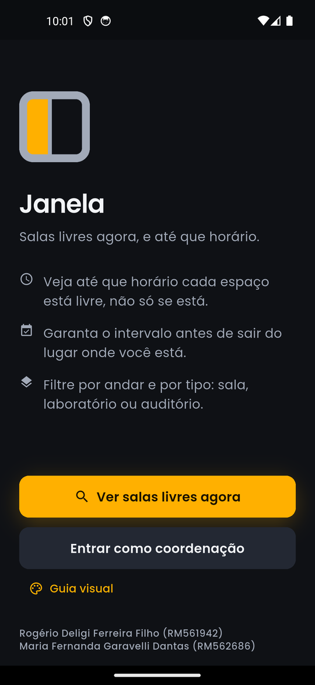
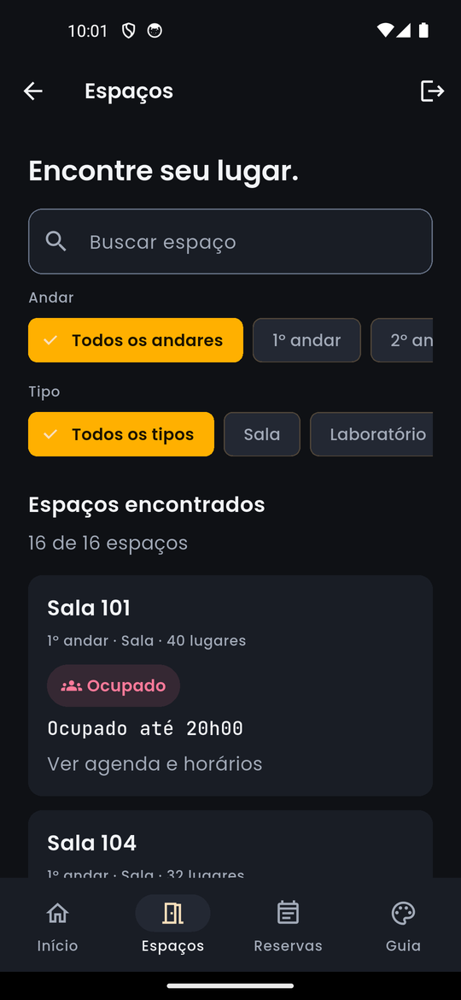
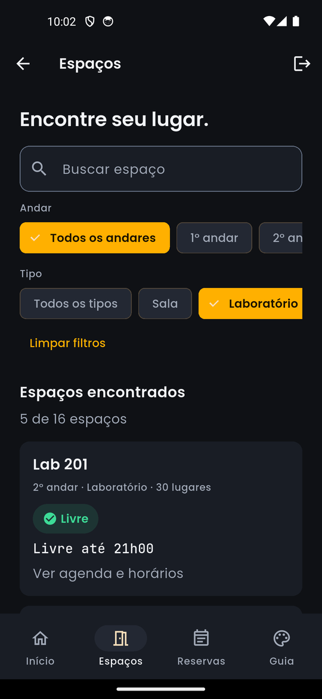
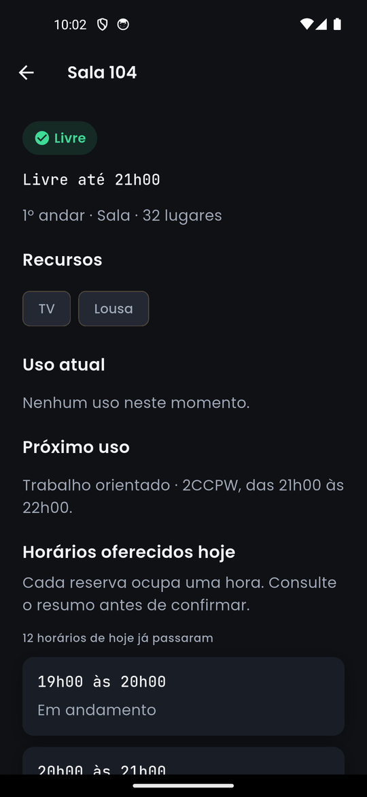
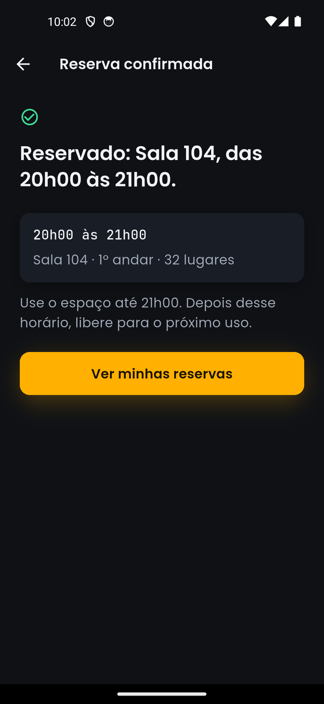
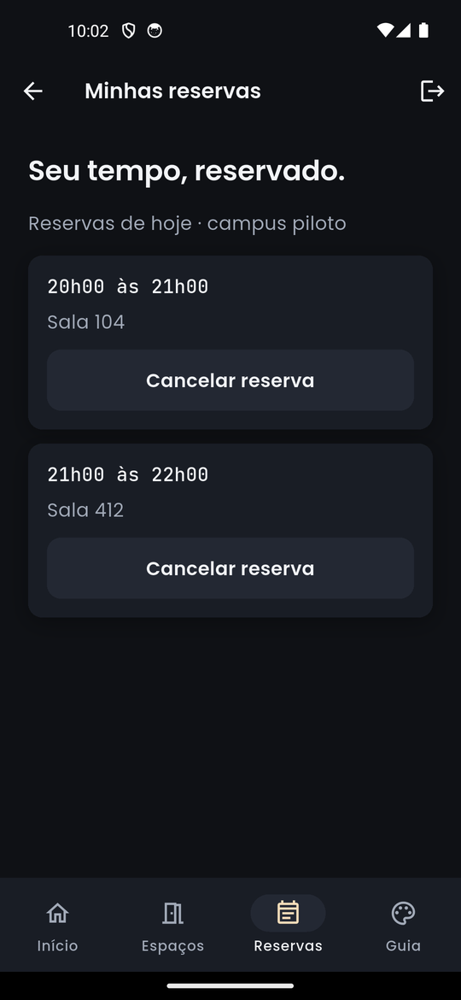
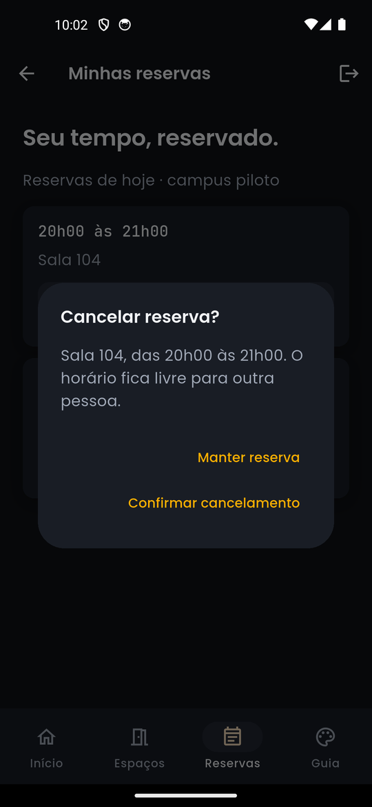
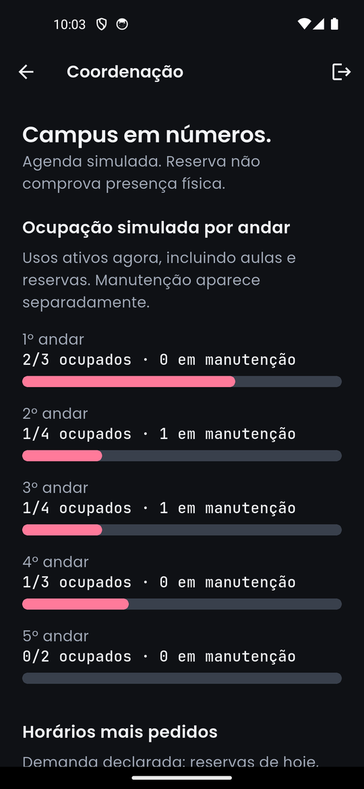
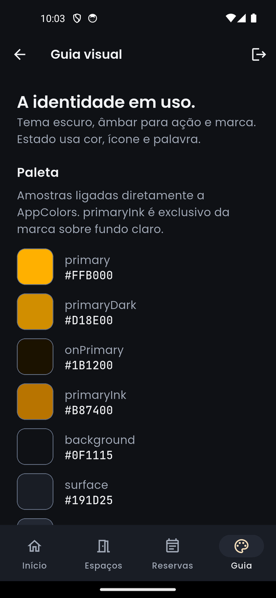

# Janela

**Salas livres agora, e até que horário.**

[Baixar o APK (v1.0.0)](https://github.com/RogerioOxy/fiap-cpad-janela-app/releases/download/v1.0.0/Janela-1.0.0.apk) · [Página da versão](https://github.com/RogerioOxy/fiap-cpad-janela-app/releases/tag/v1.0.0)


O Janela ajuda o aluno a encontrar um espaço livre no campus e saber até que horário pode usá-lo. É possível combinar filtros, consultar a agenda, reservar e cancelar horários, enquanto a coordenação acompanha a ocupação e a demanda. O app usa dados simulados e mantém as reservas em memória durante a sessão.

| Disciplina | Cross-Platform Application Development |
|---|---|
| Professor | Hercules Ramos |
| Turma | Ciência da Computação, 2CCPW, FIAP |
| Período | 2º semestre de 2026 |
| Tecnologia | Flutter 3.47.2 e Dart 3.13.2 |
| Versão declarada | 1.0.0+1 |

## Integrantes e divisão das frentes

A dupla mantém a continuidade dos checkpoints anteriores. A revisão cruzada e a apresentação são responsabilidades dos dois.

| Integrante | RM | CP4 | Frente acordada no CP5 | Frente acordada no CP6 |
|---|---|---|---|---|
| Rogério Deligi Ferreira Filho | RM561942 | Marca, naming, projeto Flutter e repositório | Shell de navegação, lista e filtros | Fluxo de reserva, geração e teste do APK |
| Maria Fernanda Garavelli Dantas | RM562686 | Identidade visual, documentação e pitch | Home, card de espaço, detalhe e mock | Aba de reservas, cancelamento e painel da coordenação |

## O que mudou desde o CP4

O CP4 entregou a entrada, a marca e um inventário com horários em texto. Nesta versão, os horários têm início e fim, o relógio é injetável, as regras impedem conflitos e o cancelamento devolve disponibilidade. O inventário contém 16 espaços em cinco andares, com recursos, aulas, manutenção e reservas fictícias. O tema mantém a identidade escura e as fontes são assets locais.

A paleta está visível neste README e no Guia visual dentro do app. As amostras leem os mesmos tokens do código. A identidade do CP4 aparece em componentes compartilhados: cards, selos com cor, ícone e palavra, botões, horários monoespaçados e barras. A navegação inferior oferece Início, Espaços, Reservas e Guia. As funcionalidades abaixo estão implementadas, cobertas por testes e foram percorridas no emulador Android 14.

## Problema, público e proposta de valor

O aluno com trabalho em grupo precisa encontrar um espaço e saber por quanto tempo pode usá-lo. A coordenação precisa consultar a demanda declarada das reservas. Sem check-in, reserva não prova presença física.

A proposta de produto está no [pitch e suas fontes](docs/PITCH.md). O protótipo usa inventário e agenda simulados, sem integração com uma instituição. A continuidade do domínio vem do [CP1 em React Native](https://github.com/RogerioOxy/fiap-cpad-cp1-salas-app) e do [CP2](https://github.com/RogerioOxy/fiap-cpad-cp2-salas-app).

## Funcionalidades e telas

As dez capturas abaixo são reais, obtidas no emulador Android 14 (API 34) com o APK de release instalado. A [captura da entrada do CP4](docs/img/tela-entrada.png) registra a referência de composição original.

| Requisito do MVP | Estado observável | Referência de imagem |
|---|---|---|
| Entrada, marca, proposta e duas portas | Abre o shell do aluno ou o painel da coordenação. Mostra os dois RMs e acesso ao Guia visual |  |
| Painel do momento | Exibe livres, ocupados e em manutenção, com atalho para Espaços |  |
| Lista com status e limite de uso | Cards mostram andar, tipo, capacidade, estado e horário-limite |  |
| Filtros por andar, tipo e nome | Chips e busca combinam filtros em tempo real; estado vazio oferece limpeza |  |
| Detalhe, recursos e agenda | Exibe uso atual, próximo uso, agenda do dia e faixas oferecidas com motivo de bloqueio |  |
| Reserva de faixa disponível | Seleção abre resumo; confirmação exibe espaço, intervalo e acesso às reservas. Conflitos exibem alternativa |  |
| Minhas reservas | Aba lista as reservas do aluno por horário e oferece atalho quando vazia |  |
| Cancelamento | Diálogo permite manter ou confirmar. Sucesso remove a reserva e devolve o horário |  |
| Coordenação | Barras nativas mostram ocupação simulada por andar e demanda declarada por hora |  |
| Guia visual na entrada e aba Guia | Renderiza 15 cores, nove estilos de texto, régua de espaçamento e componentes a partir dos tokens reais |  |

O botão de voltar retorna à tela anterior. A saída no shell e na coordenação retorna à Entrada. Trocar de porta preserva as reservas da sessão. A aba Guia corresponde ao acesso de perfil do aluno, sem autenticação real.

## Design system

A marca representa um caixilho com um vidro aceso. A interface mantém tema escuro, Poppins e acento âmbar para ação e marca. Hora e contagem usam JetBrains Mono. Estado usa sua própria escala, sempre acompanhado de texto e ícone. O [documento de marca](docs/MARCA.md) conserva naming, tom de voz, geometria e regras de uso.

### Paleta completa

As razões usam luminância relativa sRGB. O par de comparação está em cada linha. `divider` e `slotDim` são decorativos: não atendem sozinhos ao contraste de controle. `primaryInk` é exclusivo da marca sobre fundo claro e aparece no Guia como amostra identificada.

| Amostra 48x48 | Token | Hexadecimal | Papel | Contraste |
|---|---|---|---|---|
|  | `primary` | `#FFB000` | Ação e marca | 10.12:1 com `onPrimary` |
|  | `primaryDark` | `#D18E00` | Botão primário pressionado | 6.69:1 com `onPrimary` |
|  | `onPrimary` | `#1B1200` | Texto sobre ação âmbar | 10.12:1 com `primary` |
|  | `primaryInk` | `#B87400` | Marca sobre branco, uso fora da interface | 3.79:1 com `FFFFFF` |
|  | `background` | `#0F1115` | Fundo da tela | 17.15:1 com `textPrimary` |
|  | `surface` | `#191D25` | Cards e painéis | 15.32:1 com `textPrimary` |
|  | `surfaceAlt` | `#232833` | Botão secundário e superfície elevada | 13.40:1 com `textPrimary` |
|  | `textPrimary` | `#F2F4F7` | Títulos e valores | 17.15:1 com `background` |
|  | `textSecondary` | `#A2AAB8` | Metadados e apoio | 7.22:1 com `surface` |
|  | `border` | `#657084` | Contorno de controles | 3.38:1 com `surface` |
|  | `divider` | `#2C313B` | Separador decorativo, sem função informativa isolada | 1.29:1 com `surface` |
|  | `slotDim` | `#39404C` | Trilha decorativa de tempo | 1.62:1 com `surface` |
|  | `statusLivre` | `#3DDC97` | Estado livre, acompanhado de ícone e palavra | 9.55:1 com `surface` |
|  | `statusOcupado` | `#FF7A9A` | Estado ocupado e conflito, com ícone e palavra | 6.84:1 com `surface` |
|  | `statusManutencao` | `#8795AE` | Estado em manutenção, com ícone e palavra | 5.58:1 com `surface` |

```bash
python design/gerar_amostras.py
python design/gerar_amostras.py --check
```

O script usa somente biblioteca padrão, com `struct` e `zlib`; lê `lib/theme/app_colors.dart` e grava `docs/img/paleta/<token>.png`.

### Tipografia

| Token | Família | Tamanho | Peso | Altura de linha |
|---|---|---|---|---|
| brandTitle | Poppins | 32 | 600 | 40 |
| numberXL | JetBrains Mono | 32 | 600 | 40 |
| screenTitle | Poppins | 24 | 600 | 32 |
| cardTitle | Poppins | 18 | 600 | 24 |
| body | Poppins | 16 | 400 | 24 |
| button | Poppins | 16 | 600 | 20 |
| timeValue | JetBrains Mono | 16 | 500 | 20 |
| statusLabel | Poppins | 14 | 600 | 20 |
| label | Poppins | 12 | 500 | 16 |

`lib/theme/app_text.dart` define as famílias explicitamente. `pubspec.yaml` registra Poppins Regular, Medium, SemiBold e Bold e JetBrains Mono variável. Nas horas e contagens, `fontWeight` acompanha `FontVariation('wght', peso)`. As licenças OFL estão em `assets/fonts/`. Não há download de fontes durante o uso.

### Espaçamento e componentes

`AppSpacing` fornece 4, 8, 12, 16, 24 e 32; raio de card 12 e de pílula 999; botão com mínimo de 52 e marca de 88. `AppShadows` define costura de painel e brilho âmbar de ação. A coluna tem largura máxima de 480 e conteúdo rolável, com texto que quebra em telas compactas.

| Componente em `lib/widgets/janela_widgets.dart` | Uso |
|---|---|
| `CardEspaco` | Lista e exemplo no Guia, com estado e horário-limite |
| `SeloStatus` | Cor de status, ícone e palavra, sem âmbar |
| `BotaoJanela` | Ação primária âmbar, estado pressionado e variante secundária |
| `CabecalhoSecao` | Título e microcopy de apoio |
| `LinhaHorario` | Intervalo em JetBrains Mono, descrição e ação opcional |
| `BarraGrafico` | Trilha e preenchimento com `LayoutBuilder` e `Container`, valor também em texto |
| `EstadoVazio` | Mensagem específica e próxima ação |
| `confirmarAcao` | Diálogo antes do cancelamento |
| `PainelJanela` e `ConteudoJanela` | Superfícies, sombra, margens e coluna rolável compartilhadas |

Os tokens são classes Dart em `lib/theme/`, não uma imagem de referência. O registro local de fontes segue a Aula 16; a centralização dos estilos e o contrato de componentes correspondem à Aula 17.

## Arquitetura e fluxo de dados

```text
lib/models/   Espaco, Horario, Uso, Reserva, SituacaoEspaco
     ^
lib/data/     inventário + AgendaMock + ReservasRepository
     ^
lib/state/    JanelaState (ChangeNotifier, filtros e ações)

lib/screens/  entrada, shell, detalhe, reserva, coordenação, guia
     |              ação do aluno
     v
lib/state/    JanelaState -> repositório -> regra -> mutação
     |              notifyListeners
     v
ListenableBuilder -> telas e indicadores atualizados

lib/widgets/  componentes compartilhados usados pelas telas
lib/theme/    cores, tipografia, espaçamento e sombras
```

`JanelaApp` mantém uma instância de `JanelaState` para as duas portas. Shell, detalhe e coordenação usam `ListenableBuilder`. Reservar e cancelar passam pelo estado, que notifica os consumidores. O relógio renova consultas a cada minuto e ao retornar ao app; não recria a sessão.

### Decisões técnicas

- Repositório em memória como fonte única: consulta, reserva, cancelamento e painéis leem a mesma lista. Coleções compartilhadas são imutáveis para o consumidor.
- `DateTime` e intervalos semiabertos: duas reservas adjacentes são válidas; duplicatas e sobreposições do aluno em espaços diferentes são rejeitadas. Apenas faixas inteiras de uma hora oferecidas no dia são aceitas.
- Relógio `DateTime.now()` no uso normal e função injetável nos testes. O mock é criado na primeira consulta de cada dia, com abertura das 07h às 23h. Fora da abertura, a descrição informa fechamento. Na virada do dia, a agenda é reiniciada; reservas da sessão anterior não pertencem à oferta do novo dia.
- Manutenção bloqueia o espaço no dia. Aulas e reservas bloqueiam suas faixas. O aluno não reserva uma faixa já iniciada. Cancelamento só remove reservas do aluno piloto.
- Coordenação: ocupação simulada atual por andar inclui aulas e reservas ativas, com manutenção contada separadamente; demanda por hora conta reservas do mock e da sessão pelo início, sem inferir presença. Cancelamentos deixam de contar.
- Sem pacotes externos de execução e sem plugins nativos. `flutter_test` e `flutter_lints` são dependências de desenvolvimento. A configuração Android já contém `android:label="Janela"` e `applicationId="br.com.janela.janela_app"`.

## Como rodar, testar e gerar APK

Requer Flutter 3.47.2, Dart 3.13.2 e, para APK, Android SDK e JDK configurados. Na máquina da dupla, Flutter fica em `C:\Users\roger\dev\flutter\bin\flutter.bat`.

```bash
flutter pub get
flutter run
flutter analyze
flutter test
python design/gerar_amostras.py --check
flutter build apk --release
```

O APK de release foi gerado com `flutter build apk --release`, com tamanho de 47 MB, instalado e testado no emulador Android 14 (API 34). O comando grava `build/app/outputs/flutter-apk/app-release.apk`. A configuração Gradle usa assinatura de depuração no tipo release para distribuição acadêmica; não é uma configuração de publicação em loja.

Para instalar em um celular Android:

1. Baixe o [APK Janela 1.0.0](https://github.com/RogerioOxy/fiap-cpad-janela-app/releases/download/v1.0.0/Janela-1.0.0.apk) no celular.
2. Abra o arquivo baixado e permita a instalação de aplicativos de fonte desconhecida para o navegador ou gerenciador de arquivos, quando o Android solicitar.
3. Confirme a instalação e toque em Abrir para iniciar o Janela.

## Testes

`test/reservas_test.dart` cobre o inventário, contagens exatas, status e horários, filtros combinados, detalhe, regras de reserva, duplicação, conflito entre espaços, faixas adjacentes, cancelamento, titularidade, agregações, avanço do relógio, virada de dia, reinício de sessão, imutabilidade e notificações de `ChangeNotifier`.

`test/widget_test.dart` mantém a entrada, os RMs, a contagem real do painel e a verificação das fontes locais e dos pesos variáveis. `test/fluxos_widget_test.dart` cobre filtros combinados, busca sem resultados, detalhe, resumo, confirmação, presença na aba Reservas, cancelamento com as duas decisões do diálogo, retorno do horário, mensagens de conflito, manutenção, estados vazios, saída para a Entrada, barras da coordenação e tokens do Guia visual. Também cobre atualização do relógio e fluxo em tela compacta com texto ampliado. `test/correcao_widget_test.dart` verifica largura dos cards, filtros horizontais, faixas restantes, mensagens de ocupação, disponibilidade com reservas e a superfície do diálogo.

O teste de uso percorreu entrada, início, espaços, filtros, detalhe, reserva, minhas reservas, cancelamento, coordenação e guia visual no APK de release instalado no emulador Android 14 (API 34). As dez capturas em `docs/img/telas/` registram esses fluxos.

## Aprendizados do grupo

Horário em texto basta para mostrar um rótulo, mas não sustenta regra de sobreposição. Intervalos com limite final exclusivo permitem validar esse comportamento sem ambiguidade. Um relógio fixo evita testes que passam à tarde e falham de madrugada. Contagem e painel precisam ler as mesmas reservas para refletir cancelamentos. Fontes locais preservam a identidade sem rede, e uma fonte variável exige declarar o eixo de peso. O resumo precisa revalidar o horário ao confirmar: a oferta pode mudar depois da seleção. Componentes compartilhados mantêm a mesma identidade na entrada, nas telas e no Guia visual. Testes de widget exercitam navegação e decisões de diálogo, enquanto a inspeção no dispositivo verifica composição e leitura.

## Fora do escopo e por quê

| Item | Motivo |
|---|---|
| Backend e grade real | O protótipo usa dados fictícios, sem contrato com instituição ou API |
| Persistência em disco | Reservas ficam no `ChangeNotifier` e no repositório em memória; fechar o app restaura o mock. A Aula 18 apresenta `shared_preferences` e `sqflite`, alternativas que exigem plugins e configuração nativa |
| Autenticação e autorização reais | As portas representam perfis de demonstração; não há servidor nem sessão autenticada |
| Check-in, QR code e presença física | Exigem confirmação no campus; os indicadores são simulados ou de demanda declarada |
| Notificações | Exigem plugin e serviço além do processo do aplicativo |
| Mapa do andar | Exige inventário gráfico do campus e não participa das regras de reserva |
| Tema alternável | O produto aplica uma identidade escura única |
| Aprovação institucional de auditório | O inventário fictício permite reserva direta; não representa autorização de uso real |
| Publicação em loja e marca registrada | Há colisão conhecida do nome; INPI e domínio permanecem pendentes, como registrado no documento de marca |

## Licença e uso

Trabalho acadêmico da FIAP. O código e a marca são dos autores. Fontes acompanhadas das respectivas licenças OFL.
