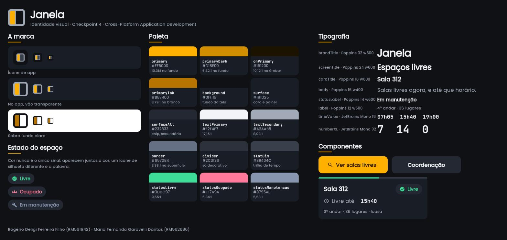
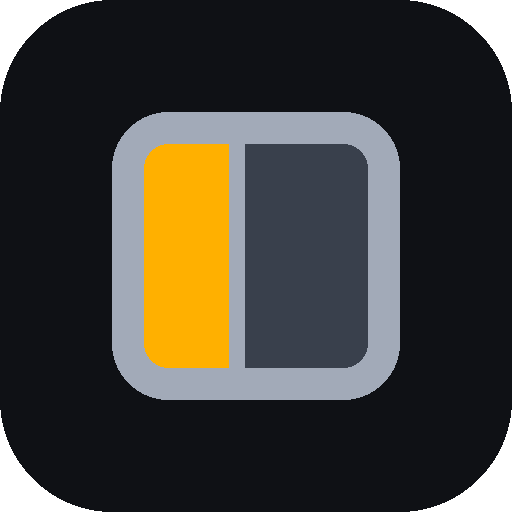

# Marca e identidade visual: Janela

Documento de marca do Checkpoint 4 de Cross-Platform Application Development. Cobre nome, naming rationale, tom de voz, paleta, tipografia e uso do logo. O que está aqui é o contrato visual do projeto: nenhuma cor e nenhuma fonte muda depois deste checkpoint, porque o CP5 tem de ser fiel ao design definido aqui.

Autores: Rogério Deligi Ferreira Filho (RM561942) e Maria Fernanda Garavelli Dantas (RM562686).



A prancha acima não foi desenhada à mão numa ferramenta de imagem: ela é uma tela Flutter que
lê os mesmos tokens que o app lê, renderizada e capturada. A consequência prática é que ela
não pode divergir da implementação, porque se a paleta mudar no código a prancha muda junto.

---

## 1. O nome

**Janela.**

### Naming rationale

Na gíria acadêmica brasileira, janela é o vão livre na grade de horário. Aluno e professor já dizem "tenho uma janela às 15h". É exatamente essa a unidade que o app vende, porque a reserva é sempre de um intervalo entre dois usos, nunca da sala inteira. O nome não descreve a função, nomeia o objeto de negócio.

Ele também guarda o gesto que o app substitui. Hoje o aluno sobe o andar e espia pela janela da porta para ver se a sala está vazia. O produto existe para tornar esse gesto desnecessário, e o nome carrega marca e problema no mesmo símbolo.

Três sílabas, seis letras, sem acento gráfico. É das palavras mais escritas do português: quem ouve uma vez escreve certo na primeira tentativa. Cabe num `AppBar` e num ícone de 48dp.

### O que o nome substituiu, e por quê

O projeto vem de dois checkpoints entregues no 1º semestre sob o nome "FIAP Salas". Ele saiu por três razões concretas. É apenas descritivo, então não há história por trás dele para contar. Usa marca de terceiro. E prende o modelo de negócio a um cliente único: não se vende "FIAP Salas" para outra universidade. O produto agora se posiciona como software para universidades em geral, com a FIAP como cliente piloto.

### Risco declarado da escolha

Não escondemos o custo, porque ele é real e verificável.

Existe um aplicativo chamado exatamente Janela no Google Play, pacote `com.janela`, que é um editor de fotos. O identificador está ocupado, então não pode ser o `applicationId` do projeto. E existe a Janela Digital, Informática e Telecomunicações S.A., software house portuguesa fundada em 1999, atuando em tecnologia para o setor imobiliário, que é adjacente a gestão de espaço.

A palavra também é substantivo comum de altíssima frequência, então a busca orgânica é ruim. E em software "janela" já significa *window*, o que é uma colisão semântica interna.

Duas decisões decorrem disso e valem para todo o projeto:

1. **A interface nunca usa "janela" como substantivo comum.** Diz sempre "livre até 15h40", nunca "há uma janela às 15h40". A regra vale em README, código, slide e apresentação, sem exceção.
2. **A consulta ao INPI (classes 09 e 42) e a registrador de domínio fica registrada como pendência**, e precisa ser feita antes de qualquer uso da marca fora da faculdade.

Leitura honesta: dentro do CP4, CP5 e CP6 a colisão é invisível e o rationale ganha. Havendo intenção de publicar na loja, isso deixa de ser risco e passa a ser impedimento a resolver antes.

### Alternativas consideradas

Duas outras finalistas saíram de uma lista de doze candidatos.

**Bancada** era a mais limpa em colisão: nenhum aplicativo ou plataforma com esse nome apareceu nas buscas. Caiu por descasamento de escopo, porque auditório e sala expositiva não têm bancada, e o inventário do app tem os três tipos. A busca orgânica também é dominada por "bancada parlamentar" e por tampo de granito.

**Encaixe** nomeava a ação que os concorrentes não executam, e era a mais afiada contra o UniEspaços da UESB. Caiu porque "encaixe" já é nome de recurso dentro de software de agendamento brasileiro, o que ancora a comparação no piso de preço da categoria, e porque reduzido a ícone sobra apenas um "E".

---

## 2. Tom de voz

Três atributos, e cada um tem consequência prática no texto da interface.

**Específico.** Nunca diz "disponível", diz até que horário. A informação que decide se o grupo senta na sala é o horário-limite, não o estado binário.

**Econômico.** Uma linha por mensagem, sem saudação e sem comemoração. Quem está de pé no corredor com o celular na mão não lê parágrafo.

**Honesto sobre o limite.** Quando o dado é simplificado, o texto avisa em vez de esconder. É por isso que o painel da coordenação diz "demanda declarada" e não "ocupação".

### Microcopy padrão

Estes textos são o padrão do produto e devem ser reaproveitados no CP5 e no CP6 em vez de reescritos.

| Situação | Texto |
|---|---|
| Estado vazio | Nenhuma sala livre agora no 4º andar. A próxima abre às 15h40, na 407. |
| Confirmação de reserva | Reservado: sala 312, das 14h às 15h30. Depois desse horário entra turma. |
| Conflito de reserva | Esse horário acabou de ser reservado por outra pessoa. Escolha outro. |
| Espaço em manutenção | Lab 305 está em manutenção hoje. Nenhum horário pode ser reservado neste espaço. |

Note o padrão: **toda mensagem negativa já traz a próxima opção dentro dela.** Estado vazio não termina em "nada encontrado", termina dizendo onde e quando há alternativa.

---

## 3. Decisão de tema: escuro

O app tem um tema só, e é escuro. O tema alternável fica de fora porque `ThemeData` global customizado é conteúdo da aula 17, ainda não ministrada.

O argumento é de cor, não de gosto. O acento âmbar só lê como luz havendo escuro em volta. Sobre branco, âmbar não lê como luz, lê como aviso, e **reprova contraste: `#FFB000` sobre branco dá 1,83:1**, abaixo de qualquer critério. O conceito da marca é luz entrando numa malha fechada, e num fundo claro a malha desaparece e a luz vira mancha.

Dois argumentos práticos somam. O público secundário é o aluno noturno olhando o celular em corredor. E o valor de exemplo do Guia Prático é `seedColor: const Color(0xFF6C63FF)` em tema claro, então tema escuro com acento âmbar distingue o app de imediato de qualquer outro feito a partir do mesmo exemplo.

O custo técnico é baixo, porque `brightness` é parâmetro nomeado do mesmo `ColorScheme.fromSeed` que o Guia ensina:

```dart
theme: ThemeData(
  colorScheme: ColorScheme.fromSeed(
    seedColor: AppColors.primary,   // 0xFFFFB000
    brightness: Brightness.dark,    // único acréscimo ao exemplo do Guia
  ),
  useMaterial3: true,
  textTheme: GoogleFonts.poppinsTextTheme(ThemeData.dark().textTheme),
),
```

Duas ressalvas registradas. A base escura entra explicitamente no `poppinsTextTheme`, porque sem ela o tema monta sobre a base clara e o texto sai quase preto sobre fundo escuro. E o `colorScheme.primary` que o `fromSeed` gera não é exatamente `#FFB000`: o Material 3 escolhe um tom mais claro da mesma família. Isso afeta apenas cursor, ripple e borda focada. Tudo visualmente decisivo recebe `AppColors.primary` explícito.

---

## 4. Paleta

Implementada em [`lib/theme/app_colors.dart`](../lib/theme/app_colors.dart). A estrutura e os nomes reaproveitam os mesmos slots do `AppColors` do Guia Prático (`primary`, `primaryDark`, `background`, `surface`, `border`). O bloco de feedback dele (`success` / `error` / `warning`) foi renomeado para o domínio, porque neste app estado de sala não é feedback de formulário.

| Token | Hex | Serve para |
|---|---|---|
| `primary` | `#FFB000` | Semente única do `ColorScheme`. Ação e marca: botão primário, chip de filtro ativo, vidro aceso do logo |
| `primaryDark` | `#D18E00` | Estado pressionado do botão primário. Reservado: o pressionado real depende de `WidgetStateProperty`, fora do escopo ensinado, então no CP4 o token existe e o botão usa o ripple da semente |
| `onPrimary` | `#1B1200` | Texto e ícone sobre âmbar |
| `primaryInk` | `#B87400` | Só a marca sobre fundo claro (capa, slide, README). Nunca na interface |
| `background` | `#0F1115` | Fundo do `Scaffold`. Neutro profundo levemente frio: o viés frio faz o âmbar ler mais quente por contraste simultâneo |
| `surface` | `#191D25` | Card, painel, `AppBar` |
| `surfaceAlt` | `#232833` | Chip inativo, botão secundário, bloco de confirmação |
| `textPrimary` | `#F2F4F7` | Nome do espaço, título de tela, valor de hora |
| `textSecondary` | `#A2AAB8` | Metadado, rótulo, microcopy de apoio, caixilho do logo |
| `border` | `#657084` | Contorno de campo de texto, onde o contorno é o que identifica o componente |
| `divider` | `#2C313B` | Linha separadora. Decorativa, nunca única indicação |
| `slotDim` | `#39404C` | Trilha da faixa de tempo (a hora que não está livre) e vão do caixilho no logo |
| `statusLivre` | `#3DDC97` | Estado livre. Menta, matiz 154° |
| `statusOcupado` | `#FF7A9A` | Estado ocupado, e a mensagem de conflito. Rosa, matiz 346° |
| `statusManutencao` | `#8795AE` | Estado em manutenção. Ardósia fria, matiz 218° |

### Regra de uso que sustenta a consistência

**Âmbar é ação e marca. Cor de status é estado.** Nenhum número de hora, contagem ou ícone informativo usa âmbar. É isso que mantém o botão como a coisa mais quente da tela, e é a tentação mais forte do CP5: espalhar âmbar pelos horários de vinte cards mata o botão.

### Contraste verificado

Razões calculadas pela fórmula de luminância relativa da WCAG 2.1, e conferidas por script. Os 26 pares foram testados; a tabela traz os que decidem legibilidade.

| Par | Razão | Veredito |
|---|---|---|
| `textPrimary` sobre `background` | 17,15:1 | passa AA e AAA |
| `textPrimary` sobre `surface` | 15,32:1 | passa AA e AAA |
| `textSecondary` sobre `background` | 8,08:1 | passa AA e AAA |
| `textSecondary` sobre `surface` | 7,22:1 | passa AA e AAA |
| `primary` sobre `background` | 10,31:1 | passa AA |
| `onPrimary` sobre `primary` | 10,12:1 | passa AA e AAA |
| `onPrimary` sobre `primaryDark` | 6,69:1 | passa AA |
| `statusLivre` sobre `surface` | 9,55:1 | passa AA |
| `statusOcupado` sobre `surface` | 6,84:1 | passa AA |
| `statusManutencao` sobre `surface` | 5,58:1 | passa AA |
| `statusManutencao` sobre `surfaceAlt` | 4,88:1 | passa AA, margem curta |
| `border` sobre `surface` | 3,38:1 | passa o mínimo de 3:1 do critério 1.4.11 |
| `primaryInk` sobre branco | 3,79:1 | passa os 3:1 de elemento gráfico |

**Dois pares reprovaram na primeira versão e foram corrigidos.** Registramos porque a correção é a parte interessante.

1. `primary #FFB000` sobre branco dá **1,83:1** e reprova qualquer critério. Correção: criamos `primaryInk #B87400` só para fundo claro, que dá **3,79:1**. É por isso que o âmbar da interface não vai para a capa do PDF.
2. `border` era `#2C313B`, que dá **1,45:1** sobre `background` e reprova o critério 1.4.11 quando o contorno é a única coisa que identifica o campo. Correção: `#657084`, que dá **3,38:1**. O `#2C313B` sobreviveu como `divider`, e só onde é puramente decorativo.

Duas ressalvas que não escondemos. `slotDim` sobre `surface` dá 1,62:1, mas é trilha vazia e não carrega informação: quem informa é o segmento colorido. E `statusManutencao` é da mesma família de matiz que `textSecondary`, então vai parecer texto cinza. Isso é proposital: sala em manutenção sai do conjunto reservável e deve recuar.

### Status nunca é indicado só por cor

Regra obrigatória para as telas de estado, que chegam no CP5. Ela está definida aqui junto com os tokens e ainda não tem consumidor no CP4, onde a única tela é a de entrada. Onde o estado aparecer, aparecem as três redundâncias juntas, sempre as três.

| Estado | Ícone | Palavra | Faixa de tempo no card |
|---|---|---|---|
| Livre | `check_circle`, círculo cheio | Livre | segmento em `statusLivre`, proporcional ao tempo restante |
| Ocupado | `groups`, silhueta de pessoas | Ocupado | segmento curto em `statusOcupado`, até liberar |
| Manutenção | `build`, chave inglesa diagonal | Em manutenção | nenhum segmento, trilha inteira em `slotDim` |

As silhuetas são deliberadamente de tipos diferentes (círculo, corpo, diagonal), porque três círculos com glifos diferentes dentro falham em 16dp.

Sobre deficiência de percepção de cor, a leitura precisa é esta: **a luminância relativa dos três status é 0,544 · 0,375 · 0,297, com passos de 1,40x e 1,23x, muito abaixo de 3:1.** Luminância sozinha não distingue. Menta e rosa também têm canal azul quase idêntico (151 e 154), então se separam sobretudo no eixo vermelho-verde, que é justamente o comprimido na deuteranopia e na protanopia. É por isso que ícone e palavra são **obrigatórios e não enfeite**: eles são o que garante a distinção, não a cor.

Nenhum verde-vermelho de semáforo em nenhum lugar, e nenhum amarelo de status, porque o amarelo é da marca e status amarelo colidiria com ele.

---

## 5. Tipografia

Implementada em [`lib/theme/app_text.dart`](../lib/theme/app_text.dart).

**Interface: Poppins**, global via `GoogleFonts.poppinsTextTheme()`. É a família do exemplo do professor, é geométrica, tem contraforma aberta e altura-x generosa.

**Números: JetBrains Mono**, via `GoogleFonts.jetBrainsMono(...)`, só em hora e contagem.

A segunda família tem motivo técnico, não estético. Poppins não resolve tabela de horas: o avanço é largo e o `1` é uma haste com bandeirola e sem base. Como a tela deste app é sobretudo uma coluna de horários, hora e contagem vão em monoespaçada, que é tabular por construção e desenhada para desambiguar `1`, `7` e `0`. Isso **não acrescenta dependência**: `GoogleFonts.jetBrainsMono(...)` é o mesmo construto `GoogleFonts.poppins(...)` da página 3 do Guia, mudando só o nome da família, no mesmo pacote.

A segunda camada da solução é de layout: a coluna de hora vive num `SizedBox(width: 64)` com `textAlign: TextAlign.right`, para que `07h05` e `15h40` ocupem a mesma caixa. Alinhamento entre linhas de lista não depende só do avanço do glifo, depende do container.

### Escala: 9 papéis em 6 tamanhos

Três papéis reaproveitam tamanho trocando de família ou de peso, e por isso não são níveis
novos: `numberXL` compartilha 32 com `brandTitle`, e `timeValue` e `button` compartilham 16
com `body`.

| Papel | Família | `fontSize` | `fontWeight` | `height` | `letterSpacing` |
|---|---|---|---|---|---|
| `brandTitle` | Poppins | 32 | `w600` | `40 / 32` | `-0.8` |
| `numberXL` | JetBrains Mono | 32 | `w600` | `40 / 32` | `0` |
| `screenTitle` | Poppins | 24 | `w600` | `32 / 24` | `-0.2` |
| `cardTitle` | Poppins | 18 | `w600` | `24 / 18` | `0` |
| `body` | Poppins | 16 | `w400` | `24 / 16` | `0` |
| `button` | Poppins | 16 | `w600` | `20 / 16` | `0.2` |
| `timeValue` | JetBrains Mono | 16 | `w500` | `20 / 16` | `0` |
| `statusLabel` | Poppins | 14 | `w600` | `20 / 14` | `0.2` |
| `label` | Poppins | 12 | `w500` | `16 / 12` | `0.4` |

O `height` está escrito como divisão literal no código, do jeito que a Aula CPAD 16 mostra: `height: 40 / 32`. Fica auto-documentado, e vale lembrar que em Flutter o `height` é **multiplicador**, não pixel: copiar o Line Height do Figma em px quebra a tela.

O `letterSpacing` é negativo em 32dp e 24dp para compensar o avanço largo do Poppins em corpo grande, e positivo em 12dp para abrir as contraformas fechadas da geométrica no tamanho onde ela mais sofre. Nada de caixa-alta abaixo de 12dp.

Regra de legibilidade: hora nunca abaixo de 14dp, e sempre com o separador `h` (`15h40`, nunca `1540`), o que dá contexto ao numeral.

---

## 6. Espaçamento, raio e sombra

Implementados em [`lib/theme/app_spacing.dart`](../lib/theme/app_spacing.dart) e [`lib/theme/app_shadows.dart`](../lib/theme/app_shadows.dart).

Régua de seis valores, todos múltiplos de 4: **4 · 8 · 12 · 16 · 24 · 32**. Padding e gap saem daí, sem exceção. Alturas de componente ficam fora da régua e também são múltiplos de 4: botão **52** (valor do exemplo do professor, mantido de propósito) e marca na entrada **88**.

Raio: **12** para card, botão, campo e imagem; **999** para pílula (chip de filtro e de status). O 12 é mais arquitetônico que o 20 do exemplo do Guia, o que combina com "malha fechada".

Duas sombras, e a segunda é a que realmente funciona no escuro:

```dart
static const BoxShadow card = BoxShadow(
  color: Color(0x4D000000),   // preto 30%, alpha em hex, notação da Aula 16
  blurRadius: 16,
  offset: Offset(0, 4),
);

static const BoxShadow accentGlow = BoxShadow(
  color: Color(0x40FFB000),   // âmbar 25%
  blurRadius: 24,
  offset: Offset(0, 8),
);
```

Honestidade sobre a primeira: sobre a base `#0F1115`, sombra preta quase não aparece, porque a luminância do fundo já é 0,0056 e escurecer não tem para onde ir. Usamos `card` de todo modo porque ela fecha a costura do card contra o fundo, mas **quem faz o card levantar é o degrau de superfície**, e esse degrau se mede em L\*, não em razão de contraste, que fica comprimida perto do preto: `background` L\*5,0 · `surface` L\*10,7 · `surfaceAlt` L\*16,1, passos de cerca de 5,5 L\*.

`accentGlow` vai só embaixo do botão primário, onde é visível de verdade, e diz literalmente o conceito da marca.

---

## 7. Logo

### O que a marca é

Um caixilho de janela com montante vertical e **um vidro aceso**. O vidro âmbar é o vão livre; o vidro escuro ao lado é a hora ocupada. Janela e disponibilidade no mesmo desenho.



### Geometria

A marca é **parametrizada, não desenhada à mão**. O script [`design/gerar_marca.py`](../design/gerar_marca.py) reproduz todos os arquivos a partir das coordenadas abaixo, num quadro de 512 por 512. A base é retângulo arredondado; o vidro aceso é recortado por máscara para acompanhar a curva do vão, e o montante é um retângulo comum. Não há gradiente e não há filtro.

| Ordem | Forma | x | y | largura | altura | raio | Cor |
|---|---|---|---|---|---|---|---|
| 1 | chapa | 0 | 0 | 512 | 512 | 112 | `background` |
| 2 | caixilho | 112 | 112 | 288 | 288 | 56 | `textSecondary` |
| 3 | vão | 144 | 144 | 224 | 224 | 24 | `slotDim` |
| 4 | vidro aceso | 144 | 144 | 85 | 224 | recortado pela forma do vão | `primary` |
| 5 | montante | 229 | 144 | 16 | 224 | 0 | `textSecondary` |

Conferências que a geometria satisfaz, todas verificadas por script:

- espessura do caixilho é 32 nos quatro lados (`144 − 112` e `400 − 368`);
- raio interno 24 = 56 − 32, o que mantém a espessura constante também na curva do canto;
- vidro aceso ocupa 38% da largura do vão;
- o vidro aceso é recortado pela forma arredondada do vão, então acompanha a curva do canto em vez de terminar em quina reta;
- nenhuma forma entra nos 56 externos de cada lado, que é a área de segurança do ícone.

Sem gradiente e sem filtro. O único recurso além do desenho direto é a máscara que recorta o vidro aceso pela forma do vão, e ela existe para o canto do vidro acompanhar a curva do caixilho em vez de terminar em quina reta.

### Versões e uso

| Arquivo | Uso |
|---|---|
| `assets/images/janela_icon_512.png` | ícone de app, launcher e README |
| `assets/images/janela_mark.png` (mais `2.0x/` e `3.0x/`) | a marca dentro do app, com o vão transparente, a 88dp |
| `assets/images/janela_mark_light.png` | a marca sobre fundo claro: capa de PDF, slide, documento |

A versão clara **inverte o caixilho** para o neutro profundo e troca o âmbar por `primaryInk`. O motivo é contraste: `textSecondary` sobre branco dá 2,34:1 e `primary` sobre branco dá 1,83:1, ambos reprovados. Com a inversão, o par passa.

Na tela de entrada, marca e nome do produto **não** entram como assinatura travada num único PNG: a marca vem por `Image.asset` e o nome vem por `Text`. Texto nativo fica nítido em qualquer densidade e permite controlar o espaçamento.

### Área de proteção e tamanho mínimo

- **Área de proteção**: um quarto da altura da marca nos quatro lados. Nada entra ali: nem texto, nem borda, nem outro logo.
- **Tamanho mínimo**: ícone de app 48 × 48. Marca sem chapa 24 × 24, porque abaixo disso a espessura do caixilho desaparece.

### Alternativas de desenho descartadas

Registramos porque a primeira versão da marca **foi reprovada em teste visual**, e a razão é instrutiva.

A proposta inicial era o caixilho com duas ranhuras escuras horizontais e uma faixa âmbar atravessando, ultrapassando as laterais para sugerir luz vazando. A geometria estava correta e simétrica, mas renderizada ela **não lia como janela**: as três barras horizontais formavam um sinal de igual, ou um ícone de menu, e a faixa atravessando lia como texto riscado, o que é o oposto semântico de um produto sobre disponibilidade. A 28px o desenho colapsava em três linhas dentro de um quadrado.

O caixilho com montante vertical e um vidro aceso foi escolhido depois de comparar oito variantes renderizadas nos tamanhos reais de uso. É a única que lê como janela em todos os tamanhos até 24px.

Também foram descartados: a cruz de quatro vidros, que lê rápido mas colide com ícone genérico de grade e com o logotipo do Windows, e não carrega tempo; o feixe diagonal de luz, que a 28px lê como barra de proibição; e o vão inteiro aceso com montantes escuros, que vira código de barras em tamanho pequeno e usa âmbar demais, quebrando a regra de acento único e escasso.

---

## 8. O que ficou fora, e por quê

| Recusado | Por que doeria | O que fazemos em lugar |
|---|---|---|
| Gradiente na luz do logo e no fundo | é o jeito natural de desenhar luz | chapa plana mais `accentGlow` como `BoxShadow`, que é `BoxDecoration` puro |
| `ThemeData` global com `cardTheme`, `elevatedButtonTheme`, `inputDecorationTheme` | eliminaria toda a repetição de estilo | é conteúdo da aula 17. Estilo repetido por widget, centralizado em `AppColors`, `AppText`, `AppSpacing` e `AppShadows` |
| `ThemeExtension` e Design Tokens gerados | design system de verdade | aula 17. Citar sem usar seria fingir escopo |
| Tema claro e escuro alternável | acessibilidade real em corredor ensolarado | aula 17. Escolhemos escuro e assumimos |
| `FontFeature.tabularFigures()` | resolveria o numeral sem segunda família | exige importar `FontFeature` de `dart:ui`, fora do ensinado. Usamos mono mais caixa de largura fixa |
| `flutter_svg` | logo vetorial nítido em qualquer tamanho | PNG em 1x, 2x e 3x via `Image.asset`, que é o fluxo da Aula 16 |
| Pacote de ícones externo | silhuetas melhores | só `Icons` nativo |
| Animação de transição e skeleton | percepção de app vivo | é conteúdo da aula 18 |
| Pacote de gráfico no painel da coordenação | é literalmente um painel | barras com `Row` mais `Expanded(flex:)` mais `Container(height:)` |
| `WidgetStateProperty` para hover e pressed | pressionado real no botão | `primaryDark` documentado, e o ripple que já vem da semente |

---

## 9. Rastreabilidade ao material da disciplina

Onde esta identidade é cópia estrutural do que foi ensinado, e onde ela saiu do material.

| Item | Origem |
|---|---|
| `class AppColors` com `static const Color` em `lib/theme/app_colors.dart` | Guia Prático p2 e p3, Aula CPAD 16 p9 |
| Nomes `primary`, `primaryDark`, `background`, `surface`, `border` | mesmos slots do `AppColors` do Guia |
| `ColorScheme.fromSeed(seedColor:)` mais `useMaterial3: true` | Guia Prático p15 |
| `textTheme: GoogleFonts.poppinsTextTheme()` | Guia Prático p4, marcado como recomendado |
| `GoogleFonts.<familia>(fontSize:, fontWeight:, color:)` por `Text` | Guia Prático p4 |
| `Scaffold(backgroundColor:)` | Guia Prático p15 |
| `SizedBox(width: double.infinity, height: 52)` com `ElevatedButton` | Guia Prático p5 e p16 |
| `ElevatedButton.styleFrom` com `shape: RoundedRectangleBorder` | Aula CPAD 16 p3, Guia p5 |
| `height: 40 / 32` como divisão literal | Aula CPAD 16 p4 |
| Conversão de cor `#RRGGBB` para `Color(0xFFRRGGBB)` | Aula CPAD 16 p3 |
| `BoxDecoration(color:, borderRadius:, boxShadow:)` | Aula CPAD 16 p6 e p10 |
| Alpha em hexadecimal (`0x4D000000`) | Aula CPAD 16 p3 e p10 |
| `Image.asset(..., width:, height:, fit: BoxFit.contain)` com export 2x e 3x | Aula CPAD 16 p5 |
| Frames externos em `double.infinity`, tamanho fixo só em elemento interno | Guia Prático p1 e p2 |
| Quebrar tela em métodos `_buildX()` | Guia Prático p5 |
| **Desvio 1**: `brightness: Brightness.dark` no `fromSeed` | parâmetro nomeado do mesmo construtor ensinado |
| **Desvio 2**: `GoogleFonts.jetBrainsMono(...)` para numeral | mesmo construto de `GoogleFonts.poppins(...)`, outra família, nenhuma dependência nova |
| **Desvio 3**: `LayoutBuilder`, `ConstrainedBox` e `IntrinsicHeight` na tela de entrada | widgets de layout do próprio Flutter, sem pacote. Não aparecem no material, e entraram para resolver um defeito real: o `Spacer` que ancora os botões no rodapé exige altura limitada, e rolar exige altura ilimitada. Sem eles a tela estourava em janela curta, o que contraria o item "testei em pelo menos dois tamanhos de tela" do checklist do próprio Guia (página 8) |
| **Desvio 4**: as classes `AppText`, `AppSpacing` e `AppShadows`, além do `AppColors` | mesma construção de `static const` que o Guia ensina para cor, aplicada a tipografia, espaçamento e sombra. O professor exigiu centralizar cor; centralizar os outros três é extensão estrutural do mesmo padrão, não recurso novo |

Os quatro desvios estão listados de propósito. Declarar o que saiu do material é mais honesto do que apresentar o projeto como aderência literal e deixar o avaliador encontrar a diferença sozinho.

Uma correção de implementação em relação ao que a Aula 16 mostra: ela fala em "export PNG 2x ou 3x", e o mecanismo real do Flutter para variante de densidade é **subpasta** (`assets/images/2.0x/`), não sufixo no nome do arquivo. Com sufixo, o 2x e o 3x nunca carregam. Os arquivos deste projeto seguem a subpasta.
